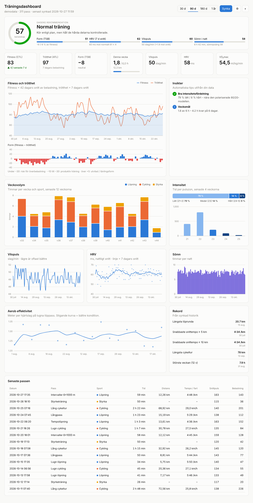

# Garmin träningsdashboard

En lokal dashboard som hämtar din Garmin-data och visar hur du mår och utvecklas, med ett konkret
träningsråd för dagen.



## Vad den visar

| Del | Vad det betyder |
|---|---|
| **Dagens rekommendation** | En beredskapspoäng 0–100 som väger ihop form (TSB), HRV mot din normalnivå, vilopuls och nattens sömn, och översätter den till *kvalitetspass / normal träning / lugnt pass / vila*. |
| **Fitness, trötthet, form** | Belastning per pass räknas som Banister-TRIMP (tid × pulsreserv). Fitness (CTL) är 42 dagars viktat snitt, trötthet (ATL) 7 dagars och form = fitness − trötthet. |
| **Veckovolym** | Timmar per sport och vecka, de senaste 12 veckorna, mot ditt veckomål. |
| **Intensitet** | Tid per pulszon de senaste 4 veckorna och fördelningen lätt/medel/hårt jämfört med 80/20-modellen. |
| **Återhämtning** | Vilopuls, HRV (med 7-dagarssnitt) och sömn per natt. |
| **Aerob effektivitet** | Meter per hjärtslag på lugna löppass. En stigande kurva betyder bättre kondition. |
| **Insikter** | Automatiska varningar och tips: för snabb ökning, hög akut belastning, för mycket tid i zon 3, sjunkande HRV, sömnbrist, veckomål. |
| **Rekord och senaste pass** | Längsta pass, snabbaste snittempo, största veckan och en tabell över senaste passen. |

## Kom igång (ingen kodning behövs)

1. **Installera Python** (gratis, en gång) från [python.org/downloads](https://www.python.org/downloads/).
   *Windows:* kryssa i **"Add python.exe to PATH"** längst ner i första installationsrutan.
2. **Ladda ner dashboarden** som en ZIP-fil från GitHub (gröna knappen **Code → Download ZIP**)
   och packa upp den, till exempel i mappen Dokument.
3. **Starta** genom att dubbelklicka på
   - **`start.bat`** på Windows. Om Windows varnar, klicka *Mer information → Kör ändå*.
   - **`start.command`** på Mac. Om Mac säger att filen inte kan öppnas: öppna *Systeminställningar → Integritet och säkerhet*, scrolla ner och klicka *Öppna ändå*. Dubbelklicka sedan på filen igen.

   Första gången tar det ett par minuter. Sedan öppnas dashboarden i webbläsaren. Låt det svarta
   fönstret vara öppet medan du använder den, och stäng det när du är klar.
4. **Koppla Garmin**: klicka på den blå knappen **Koppla Garmin**, klistra in din Personal API Key
   och tryck **Koppla**. Dashboarden hämtar ditt senaste år. Det kan ta några minuter.

Nästa gång dubbelklickar du bara på startfilen och trycker **Synka** för att hämta nya pass.

### För utvecklare

```bash
python3 -m venv .venv && source .venv/bin/activate
pip install -r requirements-dev.txt
python -m garmin_dashboard --open
```

## Koppla din Garmin-data

### Garmin Personal API (rekommenderat)

Garmins officiella, kostnadsfria API för din egen data. Det släpptes i oktober 2026.

1. Logga in på Garmin Connect på webben och skapa en **Personal API Key** under Garmins
   utvecklarsidor. Välj giltighetstid (30 dagar–1 år). Nyckeln visas bara en gång, så spara den.
2. Klistra in den via **Koppla Garmin** i dashboarden, eller lägg den själv i `.env`:
   ```ini
   GARMIN_PERSONAL_API_KEY=din-nyckel
   ```
   När nyckeln finns används Personal API automatiskt (`GARMIN_SOURCE=personal_api`).
3. Hämta historik och starta:
   ```bash
   python -m garmin_dashboard.sync --days 365
   python -m garmin_dashboard
   ```

Dashboarden använder Garmins officiella Python-klient
([`garmin-connect-personal-api-python`](https://github.com/garmin/connect-personal-api-python)).
Den byter nyckeln mot en åtkomsttoken som gäller i 24 timmar och sparas i `~/.config/garmin/`.
Därefter hämtas aktiviteter med pulszoner, dagliga sammanfattningar (vilopuls, steg, stress,
Body Battery), HRV och sömn. Maxpuls och vilopuls hämtas från dina pulszoner i Garmin tills du
ändrar dem själv under ⚙︎.

VO₂max ingår inte i Personal API, så den rutan visas inte.

**Om något ser tomt ut**: kör `python -m garmin_dashboard.probe`. Det visar strukturen på varje
svar (nycklar och typer, inte dina värden) och vad dashboarden lyckades tolka. Det är säkert att dela.

När nyckeln går ut skapar du en ny i Garmin Connect och byter värdet i `.env`.

### Alternativ: garminconnect (inofficiellt)

Biblioteket [`garminconnect`](https://github.com/cyberjunky/python-garminconnect) loggar in med
e-post och lösenord som Garmin Connect-appen. Det ger även VO₂max.

```ini
GARMIN_SOURCE=garminconnect
GARMIN_EMAIL=du@example.com
GARMIN_PASSWORD=...
```

Kör första synken i terminalen (`python -m garmin_dashboard.sync --days 365`) så att du kan skriva
in en MFA-kod. Tokens sparas sedan i `~/.garminconnect`.

## Inställningar

Under ⚙︎ i dashboarden anger du maxpuls, vilopuls, kön (påverkar TRIMP-formeln) och veckomål i
timmar. Korrekt maxpuls är viktigast: den styr både belastningen och zonuppskattningen.

## Kommandon

```bash
python -m garmin_dashboard                       # starta webbservern
python -m garmin_dashboard.sync --days 180       # synka (inkrementellt)
python -m garmin_dashboard.sync --days 365 --full  # hämta om allt
python -m garmin_dashboard.probe                 # felsök Personal API-svar
python -m pytest                                 # tester
```

## Struktur

```
garmin_dashboard/
  analytics.py      belastning, CTL/ATL/TSB, beredskap, insikter, rekord
  sync.py           hämtar från vald källa till SQLite (data/garmin.db)
  server.py         FastAPI: /api/dashboard, /api/sync, /api/settings
  sources/          demo, personal_api, garminconnect
  static/           dashboarden (HTML/CSS/JS + Chart.js lokalt)
```

All data stannar lokalt i `data/garmin.db`. `.env` och `data/` ignoreras av git.
